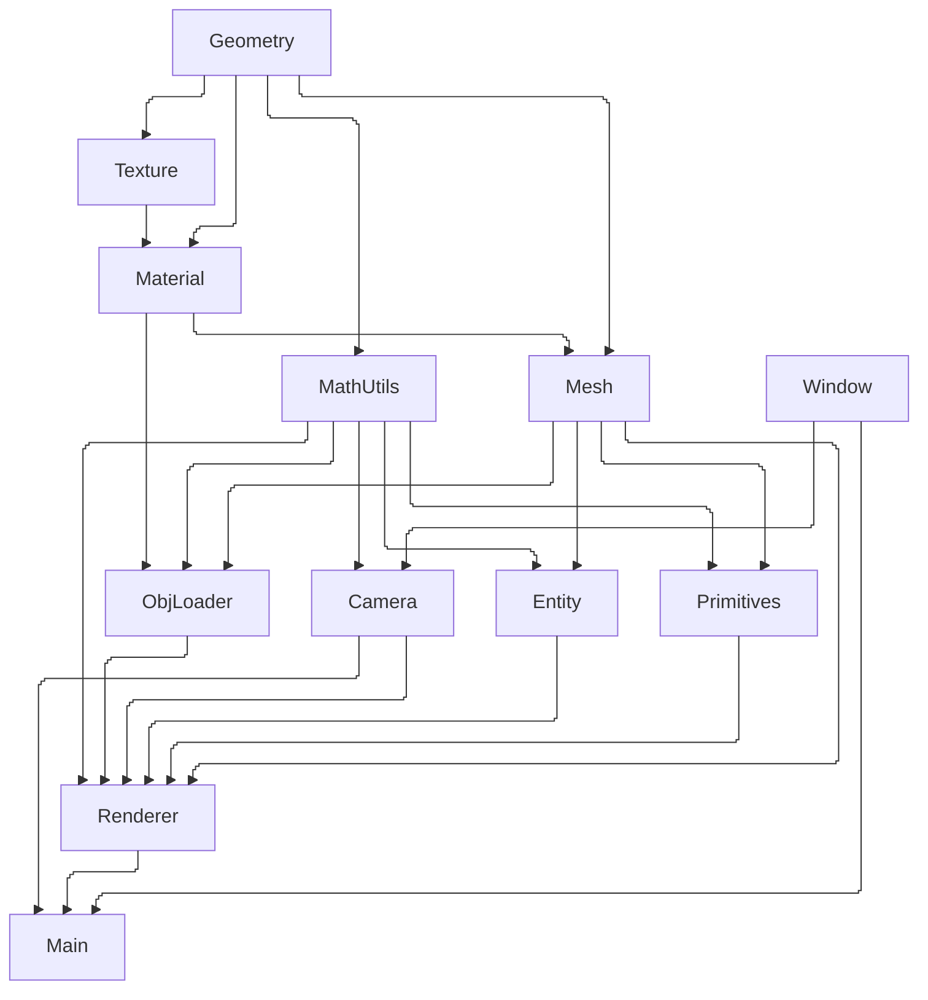

## Introduction
Over the past few months I've been working on a 3D graphics engine from scratch in C++. In December, I came across [`donut.c`](https://www.a1k0n.net/2011/07/20/donut-math.html) (an ASCII rendering of a spinning donut) and wanted to learn how it worked so I implemented it in Python and then in C++. This is how it works:
1. Create a circle of points and rotate the circle around a point to create a donut in 3D space
2. Rotate the donut by applying rotation matrices to the points
3. Use projection maths to create a z-buffer
4. Use the dot product to calculate lighting

And then you have a spinning donut in ASCII.

I extended this by changing the shade of a character instead of using different characters depending on how lit a point is, added more objects to render in addition to the donut, and created a moveable camera. The end result was satisfying but naturally I wanted to take it further by using the same concepts but varying pixels instead of characters, implementing colours, somewhat realistic shading, loading .obj files to render more interesting 3D models, rendering textures and so on. You can see the end result below:

## Architectural design

I realised Python was getting too slow even with the ASCII rendering, and since rendering individual pixels is more computationally intensive I opted to use C++. When searching for a graphics library all I needed was the ability to alter individual pixels, and access the keyboard and mouse, so I came across SDL3 and its extensive documentation convinced me to use it. Since SDL3 handles only the low-level window creation and input, everything beyond raw pixel manipulation was built from scratch. This gave me lots of freedom with the architectural design and implementation of the engine. Below is the architecture diagram of the project.



### Main function
The `main` function sets up the window, camera and renderer. It also runs the loop that handles inputs, renders the frame, and presents it while maintaining a target FPS while the program is open.

```C++
int main(int argc, char* argv[]) {
	if (!SDL_Init(SDL_INIT_VIDEO | SDL_INIT_EVENTS)) {
		return -1;
	}

	Window window("Mustafa3D", WINDOW_WIDTH, WINDOW_HEIGHT);
	Camera camera(CAMERA_POSITION, 0.0f, 0.0f, FOV);
	Renderer renderer(WINDOW_WIDTH, WINDOW_HEIGHT, camera, LIGHT_SOURCE);

	runLoop(window, renderer);

	SDL_Quit();

	return 0;
}
```
The `main` function is intentionally simple and unless altering window and camera settings, it won't be modified often.
### Renderer

Within the `Renderer` class exists a method `render` where the user can create entities within the world and modify their position and orientation. The `render` method also takes in a `deltaTime` (the time elapsed between the last two frames) which allows for motion in the simulation to be synced with real-world time, regardless of the simulation FPS. `Renderer` also contains other methods that handle colours (`applyIntensity`, `combineColours`, `packColours`) as well as methods that draw things on the screen (`drawTriangle`, `drawWireMesh` `drawMesh` and `drawLine`).

### Camera

The `Camera` class handles the camera's position and orientation through user inputs, as well as converting 3D coordinates in the world to positions on the 2D screen through projection maths. `Camera` is passed into the `Renderer` which means that you could theoretically change the `Camera` while rendering since `Renderer` takes in a `Camera` as a class variable.

### Window

The `Window` class handles user inputs and presents the frame to the user by taking in a `int* frameBuffer` (a pointer to the 1D array containing all the pixels in the screen). The keyboard inputs are detached into a `MovementKeys& movementKeys` that the `Window` updates through the `handleEvents` method. This allows for flexible use of the keyboard inputs where they are needed, for example modifying the camera's position or with a few extra lines of code to update entities and other states within the simulation too.

### Entity and meshes

`Entity` represents a particular object within the world in the memory. It takes in a `const Mesh* mesh` which consists of vertices and triangles that represent the model itself, unrelated to its position and orientation within the world. `Entity` also contains a `worldMesh` which contains `std::vector<Vertex> vertices` that represent the object within the world. When the position and orientation of the object need to be updated, `worldMesh` is altered. This is memory-intensive however, and a less memory-intensive although more computationally-intensive approach would be to not store the object's `worldMesh` and instead apply transformations (based on position and rotation vectors) to the mesh every frame.

I also created a `Primitives` class which currently contains a method to generate the mesh of a cube of a custom size. For now it only supports the cube, but it would be an easy implementation to add other primitive 3D shapes such as spheres, pyramids, etc.

Currently the size of an entity is determined by the mesh, i.e. it is not possible to change an entities size once it has been created (unless you give it a new mesh). A nicer way of implementing this would be to move the `size` property from being a part of the mesh to a property of the entity, allowing the `size` to be modified like in game engines such as Unity.

### Texture

The `Texture` class lets an image of an object's texture to be loaded, and provides a method for getting the colour on a particular point on the object using UV mapping. The `Material` class includes a `Texture* diffuseMap` as well as more material properties such as ambient, diffuse, specular, and shininess.

### File loading

3D models can be loaded (.obj files) by using the `loadMesh` function that takes in a pointer to a mesh, and loads the mesh onto it. A 3D model in .obj format is represented through vertices, vertex normals, vertex UV coordinates, and face mappings. This data is read, loaded and compiled into a mesh which includes a material that has a texture if one is given.

### Utilities

Maths utilities are provided through the `MathUtils` and `Geometry` files which allow for vector operations (2D and 3D) as well as defining a `ScreenPosition` data structure which appears to be a 3D vector.

```C++
struct ScreenPosition {
	int x, y;
	float z;
};
```

`ScreenPosition` is used to represent the position of a particular pixel on the screen, however it also includes a `float z` which is used to represent the distance to that point in the world, allowing for simpler projection maths where both a point's screen coordinates and z-values are required.

## Rasterisation

The main logic of the renderer lies within the `drawTriangle` method. It takes in 3 vertices in the world and draws on the screen the triangle that is formed by those 3 vertices. The implementation of this `drawTriangle` method varied throughout the project as different implementations had their pros and cons.

I began by using a bounding box to draw triangles. First, we use the camera's `spaceToScreen` method to turn the points in the 3D world into coordinates on the screen using projection maths. Then we can simply find the minimum x and y, and the maximum x and y coordinates to create a bounding box which is the smallest rectangle that encapsulates our triangle on the screen as shown below.



Once we have a bounding box defined, we are able to iterate over every pixel within that bounding box to determine whether it's centre lies in our triangle. We do this using barycentric coordinates which let us define any point $P$ in or on the triangle using the equation:

$$
P=uA+vB+wC
$$
where A, B, and C are the vertices of the triangle, and $u$, $v$, $w$ are our barycentric coordinates. We can obtain the coordinates using the following equations:

$$
u=\frac{[\triangle BCP]}{[\triangle ABC]}, v=\frac{[\triangle CAP]}{[\triangle ABC]}, w=\frac{[\triangle ABP]}{[\triangle ABC]}
$$
We are relying on signed areas, which gives a positive value if the points are in anticlockwise order, and a negative value if they are in clockwise order. If the point $P$ lies within our triangle, then $0\le u,v,w\le1$, which means if any of our coordinates are less than 0 or greater than 1 we can determine that the point does not lie within the triangle. This is especially useful in computer graphics, for instance we can now iterate through every pixel in our bounding box to determine whether it lies in our triangle.



This method of using a bounding box and barycentric coordinates is easy to implement but computationally intensive as we are checking whether points are in the triangle, when they aren't. I noticed this and decided to pivot into scanline rasterisation instead. Instead of creating a bounding box, we split the triangle into two triangles: a bottom half and a top half. Then we can use horizontal edge steps to find where the triangle edges land on each next scanline. And to interpolate the z-values, we use horizontal and vertical depth steps. With the addition of some upfront calculation, we have ensured that we are looping over pixels that we know are in the triangle.



Scanline rasterisation was working great until later on when I needed to interpolate more values where it became increasingly difficult to manage. With the addition of phong lighting and texture mapping, I had to interpolate the normals of the vertices along the triangle, as well as the UV coordinates too. Interpolating this many variables with scanline rasterisation manually would lead to a horrifying block of code that would involve keeping track of several presteps, steps, etc. Looking back, I could've implemented a class that includes all the values that need interpolation, and instead of interpolating each individual value, we interpolate the instance of the class, which includes all the values, perhaps a more elegant solution. Having not noticed this when developing, I painfully pivoted back to using bounding-box tile rasterisation which led to a small performance drop of the engine, but made it easier to keep adding features to the engine, the next of which was shading.

## Shading

The project began with rotating cubes with no light source or shading which meant the cubes looked very flat, and not 3D at all without including the wireframe, which gave the illusion of 3D to some extent.



An easy way to add lighting would be to implement flat shading. We give each face in the model a normal vector (e.g. $\mathbf{\hat{n}}$), and define a normalised light vector (e.g. $\mathbf{\hat{l}}$) in the world. We then take the dot product of both vectors to determine the shade of that particular face. Because our normal vectors are unit vectors, our dot product is defined as:
$$
\mathbf{\hat{n}}\cdot\mathbf{\hat{l}}=|\mathbf{\hat{n}}||\mathbf{\hat{l}}|\cos \theta=\cos \theta
$$
Therefore, the dot product varies between 1 when the vectors have the same direction, 0 when they are orthogonal, and -1 when they have opposite directions. When dot product evaluates to 0 or less, we give that face the darkest possible shade to indicate the lack of light on that face, and likewise when the dot product is positive we give the face a shade proportional to the value of the dot product, i.e. the more a face is pointing towards the light, the more lit that face would be.

Flat shading works well for cubes which lack curved faces, or in an intentionally low-poly graphics engine, perhaps something retro-style. However, as I had planned on loading complex models such as monkey heads, this method was not sufficient, and would lead to low-poly renders as shown below:



There are several other shading algorithms that support shading a smooth surface, and the one I used was Phong shading. In Phong shading, instead of giving each face a normal vector, we give each vertex in each face a normal vector. Since we are using .obj files, we cannot perfectly represent curved surfaces in data, and instead we rely on the triangulation of the 3D model to be able to represent it in a file. To make each triangle in the model curved instead of flat, we interpolate normals along the triangle using barycentric coordinates as weightings of each vertex normal.



As shown in the image above, if a point has barycentric coordinates $(u, v, w)$ then we can represent the interpolated normal as:
$$
N_I=wN_1+uN_2+vN_3
$$
Now that we are able to interpolate normals at any point on a triangle, instead of having a per-face shading calculation, we will have a per-pixel shading calculation. In other words, we are able to calculate shading at every pixel, instead of every face, leading to much more realistic rendering. By rendering per-pixel, we are able to render finer details of diffuse and specular reflection (shown in the image below).



First we calculate the `diffuseIntensity`, a value from 0 to 1 (inclusive), using the interpolated normal, the light direction, and add that to our ambient intensity (while bounding between 0 and 1). The ambient intensity is the minimum light intensity in our world, to ensure that triangles facing away from the light source are still visible and not black.

Then we access the triangle's material (all the pixels in the triangle have the same material), and get the colour at that specific pixel, either a constant colour if the material has no texture, or from the diffuse map if it does (explained in the later Textures chapter).

We then apply the diffuse intensity to this colour, the specular intensity to the specular colour (which is currently defaulted to white, as we are using white light), and combine the two to obtain a final colour, representing the colour at that pixel and update the frame buffer accordingly.

```C++
uint32_t shadedColor = applyIntensity(packColor(color), diffuseIntensity);
uint32_t specularColor = applyIntensity(0xFFFFFFFF, specularIntensity);

uint32_t finalColor = combineColours(shadedColor, specularColor);
 
m_frameBuffer[idx + P.x] = finalColor;
```



Our graphics engine has implemented Phong reflection in arguably its simplest form, using only a single light with a single colour. In a real-world use of the graphics engine, there will likely be multiple light sources, perhaps each with a different colour, causing interesting light interactions.

With a single light source we used the equation
$$E=E_A+E_D+E_S$$
($E_A$, $E_D$, $E_S$ representing ambient, diffuse and specular components of light). However with multiple light sources we simply tweak our equation to
$$E=E_A+\sum_i(E_D+E_S)$$
where we are now calculating the diffuse and specular components contributed from each light source, and combine them with our constant ambient intensity to produce the final colour for a pixel.

Additionally, there are various types of light sources, mainly directional, point and spotlight as illustrated in the diagram below. In our engine we have so far implemented directional lighting only, since we are representing light simply as a direction vector. Directional lighting works well for representing a light source such as the sun, but is insufficient for other sources such as a light bulb.



To implement a point light, instead of defining it as a direction vector (like we did with the directional light), we define it using a position vector as the name implies. This way we are able to find the direction vector pointing from a particular point on a model to the point light. In the real world, point lights follow an inverse-square law, getting dimmer as you move further away, and to implement this we could calculate the distance between the point light and the point on the model, and use an inverse-square equation to give the light intensity due to that point light.

A spotlight is essentially a hybrid of the directional and point lights we have discussed. In addition to a position and direction vector, it also is defined by one (or two) cone angles. These cone angles define the angle of the cone in which light reaches from the spotlight. If we used a single cone angle and hence a single cone, we would obtain a harsh light, where objects are lit up brightly under the spotlight but as soon as you cross out of the cone of the spotlight, they are no longer lit up. By defining an extra angle, we can have an inner cone where the light is the brightest, and an outer cone where the light fades from bright to dark, as shown in the image below showing the light intensity due to the spotlight that is shining directly down.



By implementing various types of light sources, having the ability to include multiple in a scene, and using various colours, we are able to create somewhat realistic scenes, to an extent. Where the Phong shading algorithm fails is that it is a local illumination technique, in other words it only considers a point being lit, and what it is being lit by, and nothing else in the world. This means by solely using the Phong shading algorithm, we are unable to cast shadows, or create mirrors. There are ways to overcome these limitations to extend the Phong shading algorithm, but at the cost of FPS.
## Asset loading

Loading .obj files turned out to be quite pleasant, since the way a model is formatted translates well into my data representation of a model's mesh which essentially consists of vertices and triangles.

A .obj file is a list of definitions, each defining either a vertex position, vertex normal, vertex texture coordinate (which is discussed in the next section), or a face, as shown below:

- `v` defines a vertex's position, followed by three floats denoting the x, y, and z values
- `vn` defines a vertex's normal (a direction vector), followed by three floats
- `vt` defines a vertex's texture coordinates (s or uv coordinates), followed by 2 floats
- `f` defines a face

In a model it is optional whether to define vertex normals, because if they aren't defined we can create a plane of the triangle formed by the three vertices of a particular face, and calculate its normal such that the vertices are in anti-clockwise order, and assign that as the vertex normal to the triangle's vertices.



A face can be defined in multiple ways, but in every case the position of the vertices are given. Including the texture coordinates and vertex normals is optional, but the definition changes depending on which one you follow:

- given only vertices, use `f v1 v2 v3 ...`
- when including texture coordinates too, use `f v1/vt1 v2/vt2 v3/vt3 ...`
- including both texture coordinates and normal vertices use `f v1/vt1/vn1 v2/vt2/vn2 v3/vt3/vn3 ...`
- including only vertices and their normals, use `f v1//vn1 v2//vn2 v3//vn3 ...`

Since a .obj file consists of lines of definitions, it is possible to define various faces in a model in different ways, for example defining a face with no vertex normals, and another with vertex normals. Unless you were trying to hyper-optimise on file size, this is quite uncommon, though its fun to know. Additionally a face does not necessarily need to have exactly 3 vertices, it could have more since all a face represents is a polygon in the mesh, although in most cases a model would be triangulated upon being exported, another practically useless but interesting feature of .obj files.

To implement this I read the .obj file line by line, obtaining the prefix of a definition (either `f`, `v`, `vn`, or `vt`), storing all of the vertex positions, normals and texture coordinates in arrays. We then define the mesh by appending all the vertices to a 1D array. A mesh vertex contains a `position`, `normal`, and `uv` (which is optional if there's no texture).

```C++
struct Vertex {
	Vector3 position = { 0,0,0 };
	Vector3 normal = { 0, 0, 1 };
	Vector2 uv = { 0, 0 };
};
```

Then to define faces I used a `struct Triangle` which consists of the indices of that triangle's vertices in the vertices array. This is to save on memory so we are not storing vertices in memory multiple times, and using indices makes it easy to access vertices, and allow for multiple faces to share vertices.

```C++
struct Triangle {
	unsigned int vertex1, vertex2, vertex3;
};
```

If a face is not given vertex normals, I obtained the direction vectors of two adjacent edges of the polygon, and calculated the normal using a cross product. 

Then once the mesh has been created we create a material. The values ambient, diffuse, specular, and shininess are hardcoded since .obj files do not support these values directly as they only define the geometry of a model, although we can use a .mtl (Material Template Library) file to support custom values. The material is also given a texture, if a file name for one has been given.

## Textures

To implement textures in a graphics engine we need three things: the ability to store texture coordinates in a vertex, find the colour of a point given its texture coordinates, and storing the texture's pixels. 

As shown previously, the `struct Vertex` defines the UV (texture coordinates) with `Vector2 uv = { 0, 0 }`. The term letters U and V in "UV" denote the horizontal and vertical axes of a 2D texture, since 3D space already uses x, y, and z. U, V values are bounded between 0 and 1 (inclusive) to make texture mapping resolution-independent.

We create a function method within the `Texture` class called `getColor` which takes in UV coordinates (`float u`, `float v`) and returns a vector consisting of 3 values (red, green, and blue) denoting the colour at that coordinate on the texture map. We do this by converting our UV coordinates into pixel coordinates on the texture map as below:

```C++
int x = (int)(u * (m_width - 1));
int y = (int)(v * (m_height - 1)); 
```

and then we obtain the RGB values at that coordinate, and return it.

And to store the texture map's pixels we use a 1D array that has a length equal to the product of the texture map's height and width. Each represented pixel in the array consists of 3 bytes, one for each channel (red, green, and blue).

Texture mapping allows us to map a 2D texture onto a 3D object, and by interpolating the texture coordinates across a triangle's face, we can make a seemingly perfect fit as shown below.


## Camera

To define the camera at any given point, we require its position, pitch, yaw, and FOV (field of view). Since the FOV is constant as its value is hardcoded, the camera has 5 degrees of freedom, 3 from its position (x, y, and z) and another 2 from rotation (pitch and yaw). I could've added roll too but it wouldn't make sense for a camera in this context. Pitch, yaw, and roll define the rotational axes in 3D space as shown below.



Once we have included rotation, moving the camera isn't as simple as changing the x, y, or z values. Since moving forwards, backwards, left, and right would affect both the x and z components of position (not y because the camera cannot roll). Therefore, we update the position of the camera (when moving other than vertically) using the following functions

```C++
void Camera::strafeRight(float distance) {
	position.x += m_cosYaw * distance;
	position.z -= m_sinYaw * distance;
}

void Camera::moveForward(float distance) {
	position.x += m_sinYaw * distance;
	position.z += m_cosYaw * distance;
}
```

And since the rotation does not affect the vertical movement of the camera, the method is defined intuitively as:

```C++
void Camera::moveVertical(float distance) {
	position.y += distance;
}
```

## Conclusion

Working on this project has been an enjoyable experience full of satisfying and frustrating moments which both equally led to some insightful engineering realisations throughout. I tried to make the code as modular as possible when developing, that way features could be added, removed, or edited easily without affecting the rest of the code. It is exciting to consider where this project could be headed if I work on it more, although it will remain a hobby project that is dwarfed in comparison to game/graphics engines such as Unreal, Unity, Godot, etc. If you have read this far, thank you for reading, I hope you found this project as interesting to read about as I found it interesting to develop and write about.

## Attributions
- [Phong components](https://en.wikipedia.org/wiki/File:Phong_components_version_4.png)
- [Reflection diagram](https://commons.wikimedia.org/wiki/File:Lambert2.svg)
- [Texture mapping demonstration](https://commons.wikimedia.org/wiki/File:UVMapping.png)
- [Rotational axes diagram](https://commons.wikimedia.org/wiki/File:Yaw_Axis_Corrected.svg)
